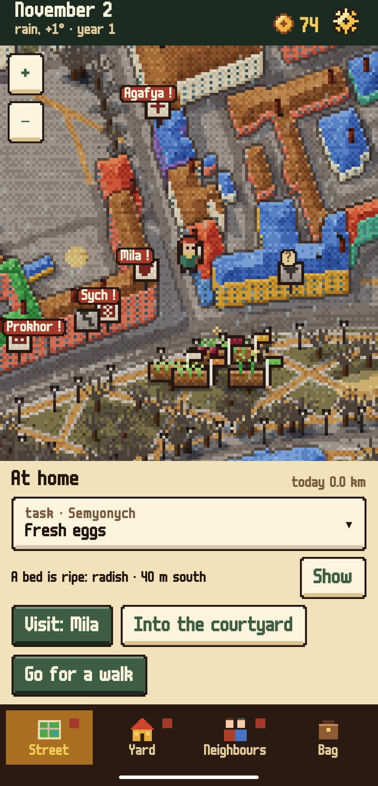
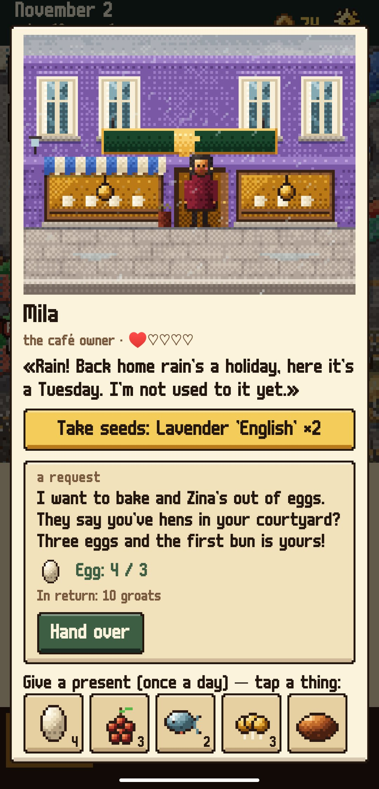
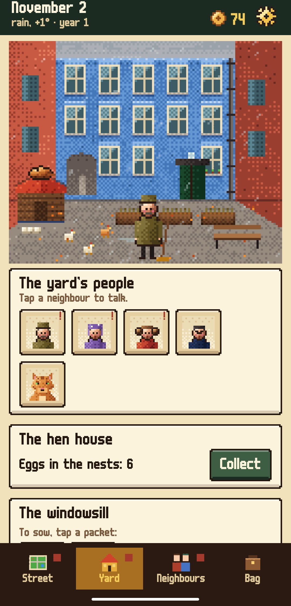
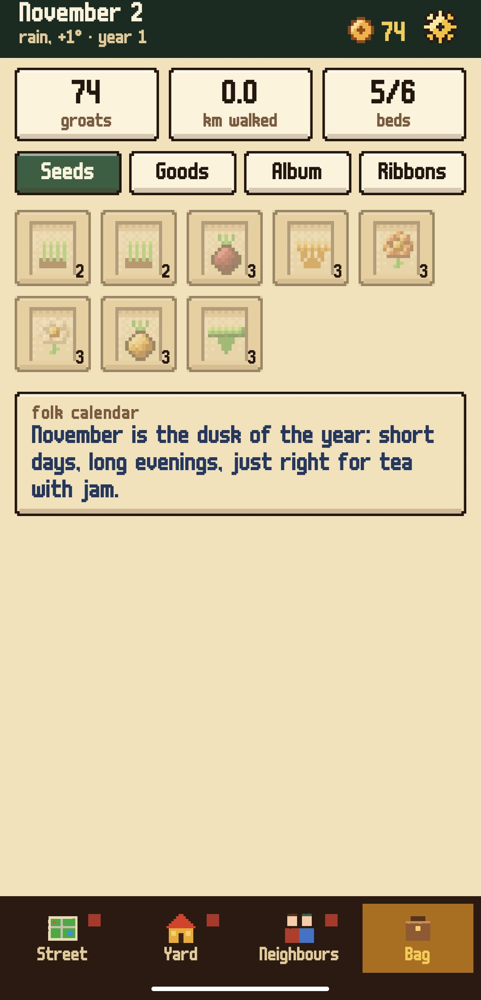

<div align="center">


# Green Street (Beta)

### A cozy farming game on the real map of your own district

*Your great-aunt has left you her hens, her yard and her old habit: planting something living along the streets of the district. Sow a bed on a lawn by the road you take every day, and walking past it waters it. Your real neighbourhood, drawn in bright pixel art from OpenStreetMap, is the farm. The bakery, the pharmacy and the market have neighbours with stories that last three years. Free, no ads, no accounts.*

[](https://github.com/bigdevwhale/greenstreet/actions/workflows/android.yml)


[](LICENSE)

**English** · [Русский](README.ru.md) · [Changelog](CHANGELOG.md)

   

**[Download the APK](https://github.com/bigdevwhale/greenstreet/releases/latest/download/GreenStreet.apk)** · Android 9+

</div>

---

> **Beta.** Everything works and the content runs for three years, but the balance is still being tuned on real walks. Bugs and ideas are welcome through the StillCraft bot (Settings → Community).

## Beds by the road

- **Sow where you walk.** Stand by a lawn next to a pavement or a park path and «Sow» appears. A stake with a flag in the plant's colour marks the bed on the map.
- **Walking past waters it.** Ten metres is enough at first, more with a better watering can. «Go for a walk» keeps it working with the phone in your pocket.
- **Rain waters for you.** A bed left alone for three days goes wild but is never lost. Frost tomorrow? The top line warns you.
- **128 varieties** with their own months, days to ripen and prices. When a sparkle shows over a bed, pick it.

## Finds on the way

Every few hundred metres something turns up, depending on the place, the month and the weather: morels after rain, rowan in frost, a driftwood branch by the water, a forgotten packet of seeds on a bench, a groat by the kerb, a neighbour's lost mitten to take back, or just a moment worth seeing. With the phone in your pocket, a find comes as a quiet notification.

## The yard

The hen house (eggs every day), pots on the windowsill, a kitchen with 95 recipes, the notice board and the people of your yard: Semyonych the caretaker, Nina Petrovna from the ground floor, and Pryanik the ginger tom who must not be fed sausage. The yard is drawn after your real home: an old city courtyard, a block of flats or a house of your own.

## Neighbours

Their places are real shops and buildings of your district: the bakery, the pharmacy, the library, the market. Each one gives seeds once a day, takes a present once a day (and shows what they like), and asks for help. The requests come one after another and tell their stories over three years: 735 requests and 474 letters in all.

## What the groats are for

- **The fair.** On Saturdays Aunt Zina's market buys your harvest. One crop is in demand every week and sells for twice the price.
- **The household.** Eight upgrades, each changing one rule: more bed places, more eggs, mulch so beds wait a week, frost fleece, a compost box, a forager's basket, a window shelf, your own stall at the fair.

## Three years

The first opening tasks teach everything one step at a time. Then the year turns: festivals, a folk calendar for every day, a balcony and beehives in the second year, a shared garden for the whole yard in the third.

## Privacy

The map of your district is downloaded once from OpenFreeMap (OpenStreetMap data) and kept on the phone. The weather comes from MET Norway (forecast) and Open-Meteo (what has already fallen); both get only rounded coordinates. Your position never leaves the phone: no accounts, no analytics, no ads.

## Build

```
./gradlew assembleDebug                      # app.greenstreet.dev
./gradlew assembleDebug -Pdemo               # app.greenstreet.demo: Petrogradka, St Petersburg, a season already growing
./gradlew testDebugUnitTest                  # incl. a four-year pacing test of the stories
./gradlew testDebugUnitTest -Prender         # the map and the scenes to PNG in app/build/art
python tools/build_content.py && python tools/check_content.py   # content TSV from tools/content_src
```

Kotlin, Jetpack Compose, org.json. All the pixel art (the district, the yard, the shop fronts, the neighbours, every item icon) is drawn in code.

## License

MIT. Map data © OpenStreetMap contributors (ODbL), tiles by OpenFreeMap; weather by MET Norway and Open-Meteo.com (CC BY 4.0). Font: m6x11 by Daniel Linssen.
