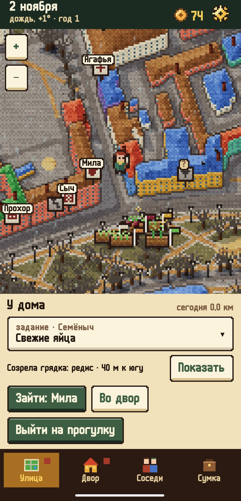
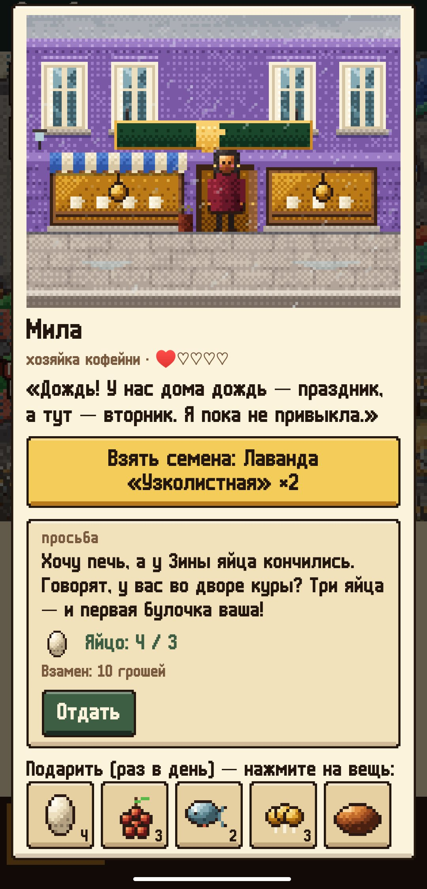
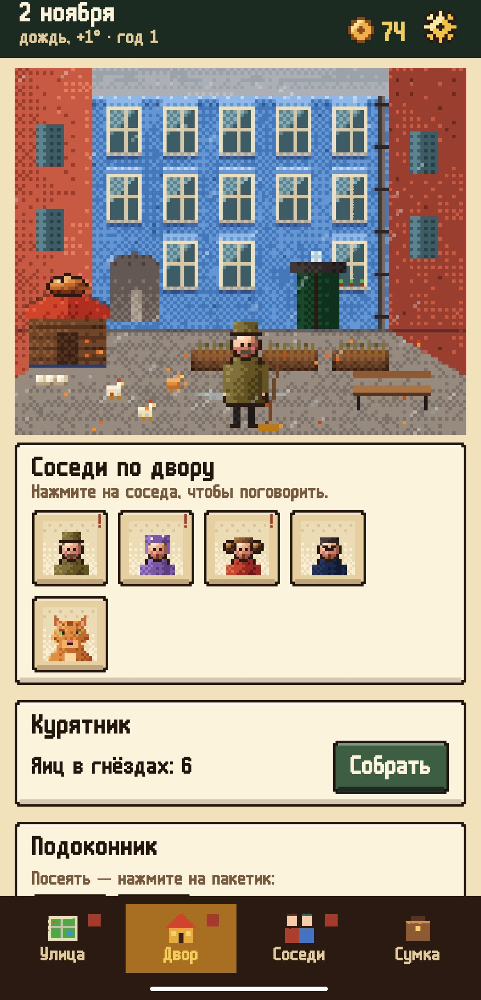
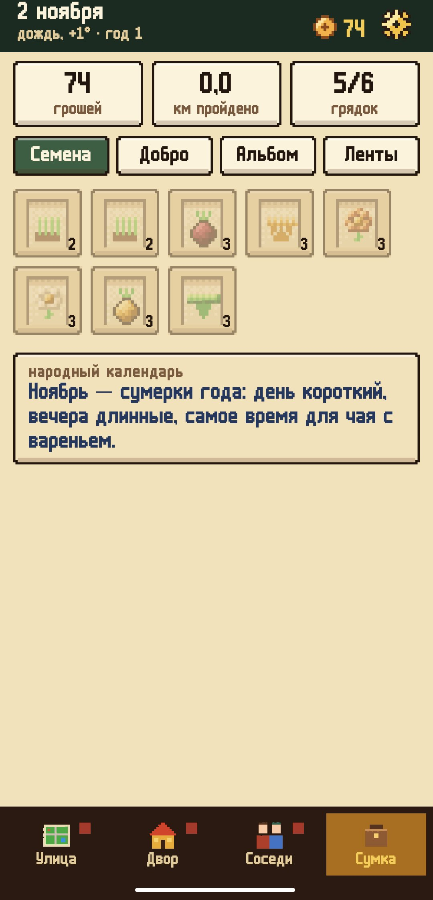

<div align="center">


# Зелёная улица (Beta)

### Уютная ферма на настоящей карте вашего района

*Двоюродная бабушка оставила вам кур, двор и свою давнюю привычку — сажать что-нибудь живое вдоль улиц района. Разбейте грядку на газоне у дороги, по которой ходите каждый день, — и она будет полита всякий раз, когда вы проходите мимо. Ферма — это ваш настоящий район, нарисованный яркими пикселями по OpenStreetMap. В пекарне, аптеке и на рынке вас ждут соседи, и их истории растягиваются на три года. Бесплатно, без рекламы и аккаунтов.*

[](https://github.com/bigdevwhale/greenstreet/actions/workflows/android.yml)


[](LICENSE)

[English](README.md) · **Русский** · [Изменения](CHANGELOG.md)

   

**[Скачать APK](https://github.com/bigdevwhale/greenstreet/releases/latest/download/GreenStreet.apk)** · Android 9+

</div>

---

> **Бета-версия.** Всё уже работает, и историй хватит на три года, но баланс ещё подгоняется по настоящим прогулкам. Об ошибках и идеях пишите через бота StillCraft (Настройки → Сообщество).

## Грядки у дороги

- **Сажайте там, где ходите.** Встаньте у газона рядом с тротуаром или парковой дорожкой — появится «Посеять». На карте грядку отмечает колышек с флажком цвета растения.
- **Прошли мимо — полили.** Сначала хватает десяти метров, с лейкой получше — больше. «Выйти на прогулку» — и всё работает, даже когда телефон в кармане.
- **Дождь поливает сам.** Грядка без присмотра через три дня дичает, но не пропадает. Если завтра заморозок, об этом скажет верхняя строка.
- **128 сортов**, у каждого свои месяцы посева, сроки и цена. Над созревшей грядкой блестит искорка — пора собирать.

## Находки по дороге

Каждые несколько сотен метров что-нибудь находится — смотря где вы, какой месяц и какая погода. Сморчки после дождя, рябина в мороз, коряга у воды, забытый на скамейке пакетик семян, грош у бордюра, потерянная соседом варежка, которую надо вернуть, — или просто что-то, на что стоит посмотреть. Если телефон в кармане, находка приходит тихим уведомлением.

## Двор

Курятник (яйца каждый день), горшки на подоконнике, кухня на 95 рецептов, доска объявлений и жильцы вашего двора: дворник Семёныч, Нина Петровна с первого этажа и рыжий кот Пряник, которого нельзя кормить колбасой. Двор рисуется по вашему настоящему дому: старый двор-колодец, многоэтажка или свой дом.

## Соседи

Их места — настоящие магазины и здания вашего района: пекарня, аптека, библиотека, рынок. Каждый раз в день дарит семена, принимает подарок (по ответу понятно, что ему по душе) и просит помочь. Просьбы приходят одна за другой и складываются в истории на три года: всего 735 просьб и 474 письма.

## На что гроши

- **Ярмарка.** По субботам рынок тёти Зины покупает урожай. Каждую неделю какой-то урожай в цене, и за него дают вдвое больше.
- **Хозяйство.** Восемь улучшений, каждое меняет одно правило: больше мест под грядки, больше яиц, мульча, чтобы грядки ждали неделю, укрывной материал от заморозков, компостный ящик, корзинка грибника, полка на окно и свой прилавок на ярмарке.

## Три года

Первые задания шаг за шагом показывают, как всё устроено. Дальше год идёт своим чередом: праздники, народный календарь на каждый день, на второй год — балкон и ульи, на третий — общий сад для всего двора.

## Приватность

Карта района один раз скачивается с OpenFreeMap (данные OpenStreetMap) и хранится на телефоне. Погода — от MET Norway. Где вы ходите, знает только ваш телефон: ни аккаунтов, ни аналитики, ни рекламы.

## Сборка

```
./gradlew assembleDebug                      # app.greenstreet.dev
./gradlew assembleDebug -Pdemo               # app.greenstreet.demo: Петроградка, сезон уже в разгаре
./gradlew testDebugUnitTest                  # в том числе тест темпа историй на четыре года
./gradlew testDebugUnitTest -Prender         # карта и сцены в PNG, app/build/art
python tools/build_content.py && python tools/check_content.py   # TSV-контент из tools/content_src
```

Kotlin, Jetpack Compose, org.json. Весь пиксель-арт — район, двор, витрины, соседи, все иконки вещей — нарисован кодом.

## Лицензия

MIT. Данные карты © участники OpenStreetMap (ODbL), тайлы OpenFreeMap; погода — MET Norway. Шрифт m6x11 — Daniel Linssen.
